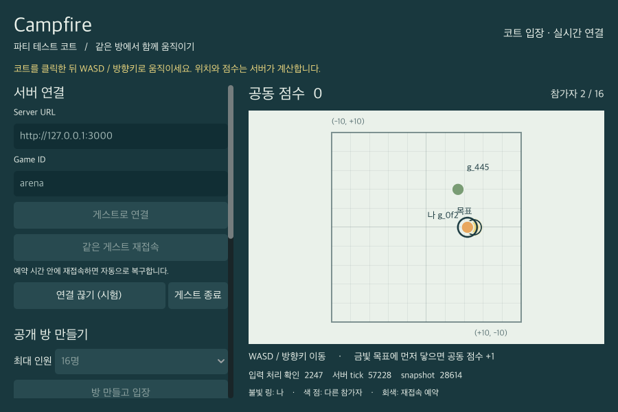

# Campfire

**협동·파티 게임을 위한 Rust 실시간 룸 서버.**

게스트 연결, 방 만들기와 참여, 상태 동기화, 재접속까지 공통으로 처리하고 게임 규칙은 Rust 모듈로 작성하세요. Campfire는 여러 게임이 하나의 서버 기반을 공유하면서도 `game_id`별로 세션과 방을 격리하는 서버 프레임워크입니다. 바로 플레이할 수 있는 Godot 2D arena 예제를 함께 제공합니다.

[빠른 시작](#빠른-시작) · [다른 Rust 서버에서 사용하기](#다른-rust-서버에서-사용하기) · [검증 결과](#확인한-동작) · [개발자 문서](#개발자-문서)



*실제 native Godot 클라이언트 화면입니다. 두 창이 같은 서버·방에 연결된 상태에서 이동 동기화를 확인했습니다. [두 창 실행 기록과 원본 증거](docs/godot-two-windows-2026-10-18.md)*

## 게임 규칙에 집중하세요

룸 기반 협동·파티 게임을 만들 때마다 연결과 재접속 흐름을 다시 구현하고 싶지 않은 Rust 개발자를 위한 출발점입니다.

- **게스트에서 같은 방까지:** HTTP 게스트 발급과 JSON WebSocket, 공개 방 생성·목록·입장을 제공합니다.
- **서버가 계산하는 상태:** arena 예제는 방향 입력을 검증하고 위치·공동 점수를 계산합니다. 기본 30Hz tick과 15Hz full snapshot으로 상태와 입력 처리 번호를 전송합니다.
- **끊겨도 같은 자리로:** 기본 30초 동안 자리를 예약하고, 같은 게스트가 재접속하면 최신 full sync로 복구합니다. arena 예제는 예약 중 캐릭터를 정지시킵니다.
- **게임별 연결·방 격리:** 게스트 발급부터 인증·목록·입장·resume까지 `game_id` 경계를 검사합니다.
- **교체할 수 있는 게임 모듈:** `GameModule`과 `Game`에 규칙을 구현하고 필요한 모듈만 서버에 등록합니다. 게임 callback은 Axum이나 WebSocket 타입을 받지 않습니다.

## 빠른 시작

Git, **Rust 1.96 이상**, **Godot 4.7.2**가 필요합니다. 아래 명령은 `godot`가 PATH에 있는 환경 기준입니다.

### 1. 서버 실행

```sh
git clone https://github.com/sangjinsu/campfire.git
cd campfire
cargo run -p campfire-server -- --bind 127.0.0.1:3000 --game arena --capacity 16
```

### 2. Godot 창 두 개 열기

저장소 루트의 다른 terminal에서 실행하세요. 두 번째 창은 또 다른 terminal에서 같은 명령으로 실행합니다.

```sh
godot --path examples/godot
```

Godot 편집기로 `examples/godot/project.godot`를 열고 F5로 실행해도 됩니다.

### 3. 같은 방에 참여하기

첫 창에서 **게스트로 연결 → 방 만들고 입장**, 두 번째 창에서 **게스트로 연결 → 새로고침 → 방 선택 → 선택한 방 입장**을 누르세요. 기본 Server URL은 `http://127.0.0.1:3000`, Game ID는 `arena`입니다.

코트를 클릭한 뒤 **WASD / 방향키**로 이동합니다. 금빛 목표에 먼저 닿으면 공동 점수가 증가합니다. **연결 끊기 (시험) → 같은 게스트 재접속**으로 복구도 확인할 수 있습니다. 자세한 조작과 재접속 조건은 [Godot 예제 안내](examples/godot/README.md)에 있습니다.

Godot 없이 HTTP → WebSocket → 입력 → 재접속 전체 흐름을 확인하려면 서버를 켠 상태에서 다음 예제를 실행하세요.

```sh
cargo run -p campfire-server --example headless -- http://127.0.0.1:3000 arena
```

## 다른 Rust 서버에서 사용하기

**가능합니다.** `campfire-runtime`은 실행 바이너리와 분리된 library crate입니다. 현재 저장소의 crate를 path dependency로 사용해 아래 방식으로 적용할 수 있습니다.

| 만들고 있는 것 | 활용 방법 |
|---|---|
| 새로운 Rust 게임 | `GameModule`/`Game`을 구현하고 `Campfire::register_game()`으로 등록합니다. arena가 구현 예제입니다. |
| 기존 Axum 0.8 서버 | `Campfire::router()`를 기존 router와 합성합니다. Campfire의 게스트·룸 프로토콜은 그대로 사용합니다. |
| 다른 Rust 웹 프레임워크 | Campfire를 별도 서비스로 실행하고 HTTP/JSON WebSocket 프로토콜로 연동할 수 있습니다. 해당 프레임워크 전용 내장 adapter는 제공하지 않습니다. |

현재 게임 계약은 플레이어별로 tick 사이의 최신 유효 입력 하나를 적용하고, 전원에게 같은 공개 게임 상태를 전송합니다. 개별 행동을 모두 처리하려면 별도 명령 처리 설계가 필요하며, 플레이어별 비공개 view는 공개 API 확장이 필요합니다. 기존 로그인·DB 연결과 내부 룸 actor를 직접 제어하는 transport도 별도 통합 범위입니다. [의존성 설정과 Axum 합성 예제](docs/reuse.md)에서 연결 방법을 확인하세요.

같은 arena 모듈을 두 게임으로 등록해 격리된 방 목록을 사용할 수도 있습니다.

```sh
cargo run -p campfire-server -- --game arena --game arena-b
```

`--game`은 컴파일된 모듈의 등록 ID를 정합니다. 다른 게임 규칙은 Rust 모듈을 추가한 뒤 다시 빌드합니다.

## 작은 구성, 분리된 역할

| Crate | 역할 |
|---|---|
| [`campfire-runtime`](crates/campfire-runtime) | 게스트 세션, 룸 task, tick·snapshot, 재접속, 자원 상한, Axum transport |
| [`campfire-arena`](crates/campfire-arena) | 서버가 위치와 공동 점수를 계산하는 2D 게임 모듈 |
| [`campfire-server`](crates/campfire-server) | 모듈 등록, CLI·환경 변수, 실행과 종료를 묶는 예제 바이너리 |

`arena`는 기본 Cargo feature입니다. 전용 서버는 필요한 게임 crate만 포함해 구성할 수 있습니다. Godot 플레이 화면과 공용 client adapter는 [`examples/godot`](examples/godot)에 있습니다.

## 확인한 동작

아래 결과는 **macOS arm64의 TCP loopback 환경**에서 실행한 기록입니다. 서버·클라이언트 검증과 실제 플레이 화면 확인을 각각 남겼습니다.

| 검증 | 확인한 범위 | 실행 기록 |
|---|---|---|
| Rust WebSocket client 8명 / 16명 | 각각 실제 60초, 입력 처리와 snapshot 수신. client별 snapshot 간격 p95 최대 약 69ms / 71ms | [서버 검증](docs/verification-results.md) |
| 실제 Godot 프로세스 8개 / 16개 | 각각 약 20초, 전원의 동일 snapshot 상태·원격 이동·동일 게스트 resume | [Godot 자동 검증](docs/godot-autotest-2026-10-18.md) |
| Native Godot UI | 실제 scene의 연결·생성·입장·이동·재접속 등을 포함한 28개 검증 | [UI 검증과 캡처](docs/godot-autotest-2026-10-18.md#실제-godot-실행-결과) |
| Native Godot 창 두 개 | 같은 방의 참가자 2명, 양방향 이동 반영과 연결 유지 | [두 창 확인](docs/godot-two-windows-2026-10-18.md) |
| 서버 회귀·경계 조건 | 빠른 테스트 44개, 기본 30초 재접속 경계, 느린 reader 격리, 게임 간 입장 차단 | [요구별 검증 추적표](docs/verification-coverage.md) |

인터넷 환경의 지연, 대규모 CCU, 장기간 운영 성능은 이 결과에 포함되지 않습니다. 재현 명령과 원본 JSON·로그는 각 문서에 연결되어 있습니다.

## 운영 범위

현재는 **단일 노드·인메모리 runtime**입니다. 서버 재시작 시 세션과 방이 초기화됩니다. queue·연결·세션·룸 상한과 처리 지표를 제공하며, 외부 공개 시 TLS 종료 계층(reverse proxy 등)이 필요합니다. 영속 DB, 분산 룸 directory와 기존 계정 시스템은 별도 통합 범위입니다. 게임 callback은 신뢰하는 동기 Rust 코드이므로 blocking I/O나 무한 계산을 피해야 합니다.

## 개발자 문서

- [게임·서버 재사용 가이드](docs/reuse.md) — Rust API, Axum 합성, 다른 프레임워크 적용 범위
- [Godot 예제](examples/godot/README.md) — 실행, 조작, 재접속, 테스트
- [JSON 프로토콜](docs/protocol.md) — guest·room·input·resume 메시지와 오류
- [설정](docs/configuration.md) — CLI·환경 변수·기본값·상한
- [설계 사양](docs/specification.md) — runtime과 게임 모듈의 책임
- [서버 검증](docs/verification-results.md) · [Godot 검증](docs/godot-verification.md) — 실행 명령, 측정값, 원본 증거
