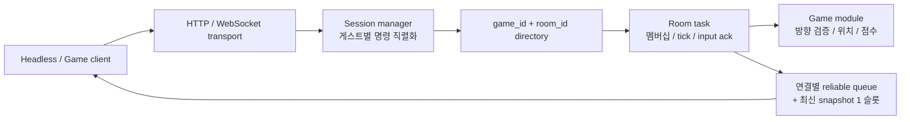

# Campfire

Campfire(캠프파이어)는 여러 협동·파티 게임이 게스트 인증, 연결, 룸 운영과 실시간 상태 전송을 공유하는 Rust 서버 프레임워크다. 게임 규칙은 정적 Rust 모듈로 분리하며 한 바이너리에 선택한 모듈만 포함할 수 있다. 첫 예제는 서버가 위치와 공동 점수를 계산하는 2D arena다.

구현 요구의 원문은 [사양서](docs/specification.md), wire contract는 [protocol](docs/protocol.md), CLI와 기본값은 [설정](docs/configuration.md), 라이브러리 API 근거는 [공식 API 조사](docs/api-research.md)에 있다. 원문 사양의 상태 문구는 제공된 문서를 그대로 보존한 것이다. 실행한 검증의 범위와 측정 결과는 [검증 결과](docs/verification-results.md)와 [요구별 검증 추적표](docs/verification-coverage.md)에 기록한다. [최종 Architect 검토](docs/architect-review.md)는 blocking finding 없이 승인됐다.



각 룸 task만 자신의 게임 상태와 자리를 수정한다. 세션 manager는 한 게스트의 중복 인증·입장·퇴장을 직렬화하고, transport는 프레임 제한과 단일 writer를 맡는다. `Game`은 Axum이나 WebSocket 타입을 받지 않는 동기 callback 계약이다. 새 게임을 추가할 때 [game.rs](crates/campfire-runtime/src/game.rs)의 `GameModule`/`Game`을 구현하고 composition root에서 `runtime.register_game("my-game", MyModule)?`로 등록한다.

Rust 1.96 이상과 Cargo가 필요하다(`edition = "2024"`, workspace `rust-version = "1.96"`). 현재 검증 toolchain은 Rust 1.96.1이다.

```sh
cargo run -p campfire-server -- --bind 127.0.0.1:3000 --game arena --capacity 16
```

다른 terminal에서 실행 가능한 [headless 예제](crates/campfire-server/examples/headless.rs)를 실행한다. 예제는 HTTP 게스트 발급 → WS 인증 → 생성/자동 입장 → 방향 입력/처리 snapshot → 단절 → 새 연결 인증 → resume full sync → 퇴장 → 로그아웃까지 같은 게스트로 이어간다. token은 출력하지 않는다.

```sh
cargo run -p campfire-server --example headless -- http://127.0.0.1:3000 arena
```

다른 클라이언트의 룸 입장은 `room.list`(`cursor:null`, `limit:20`)로 받은 `room_id`와 `room_instance_id`를 `room.join`에 전달한다. 생성과 입장의 full sync에 포함된 instance를 이후 입력·퇴장·resume에도 그대로 사용한다. 각 command에 고유한 request_id를 넣고, `game.input.accepted`가 아닌 snapshot의 `last_processed_input_seq`를 처리 확인으로 사용한다. 전체 JSON 예제는 protocol 문서에 있다.

기본은 16명, 30Hz tick과 15Hz full snapshot이다. arena는 tick마다 최신 유효 방향 하나로 `direction * speed * fixed_dt`를 한 번 적용하고 대각선을 정규화한다. 기본 경계는 ±10, speed 5, 목표는 (5,0)이며 반경 0.5 안에 먼저 도착하면 공유 점수가 한 번 증가한다. 단절하면 보관 방향을 0으로 바꾸고 예약 만료 전까지 정지한다. 클라이언트의 위치·점수나 알 수 없는 입력 필드는 거부한다.

게임 ID는 token 발급부터 접속·목록·입장·resume까지 격리한다. 같은 arena factory를 두 독립 namespace에 등록하는 실행 예시는 다음과 같다.

```sh
cargo run -p campfire-server -- --game arena --game arena-b
CAMPFIRE_CAPACITY=8 CAMPFIRE_GAMES=arena cargo run -p campfire-server
cargo run -p campfire-server -- --help
```

`arena` Cargo feature가 기본 활성화되어 있다. `--game`은 컴파일된 factory의 등록 ID를 선택한다. 전용 바이너리는 불필요한 모듈 의존성/feature를 제외하고 필요한 factory만 등록한다. 이 workspace에서 다음 명령으로 arena 제외 및 명시적 포함 빌드를 확인할 수 있다. 제외 빌드는 등록 게임이 없으므로 실행 시 설명과 함께 종료한다.

```sh
cargo build -p campfire-server --no-default-features
cargo build -p campfire-server --no-default-features --features arena
```

상한은 모두 유한하며 CLI/env 또는 `Config`로 조절한다. 외부 HTTP는 게스트 발급, WS와 `/health`만 제공한다. bearer token은 URL/log에 넣지 않고 외부 환경에서는 HTTPS/WSS로 전달한다. 로그는 game/room 식별자와 처리 지연·queue/수용량 지표를 기록하며 raw command와 token을 출력하지 않는다. Ctrl+C/SIGTERM은 runtime 종료 신호를 전달하고 룸 종료 및 connection permit 반환을 기다린다. tick 처리 예산을 넘으면 game/room 식별자와 경고를 기록하고, 입력 처리 시간은 `max_input_duration_micros`로 관측한다. 이 측정은 신뢰 코드의 실행을 강제 중단하지 않는다.

```sh
cargo fmt --all -- --check
cargo check --workspace --all-targets --all-features --locked --offline
cargo clippy --workspace --all-targets --all-features --locked --offline -- -D warnings
cargo test --workspace --all-features --locked --offline
cargo test -p campfire-server --test headless --all-features --locked --offline -- --ignored --nocapture --test-threads=1
```

의존성이 아직 로컬에 없으면 먼저 `cargo fetch --locked`로 가져온 뒤 `--offline` 검증을 실행한다. 현재 root의 독립 실행에서 formatting, all-target/all-feature clippy, 빠른 테스트 44개 및 arena 포함/제외 빌드가 통과했다. 실제 8명/16명 각 60초, 31초 재접속 경계와 느린 reader 격리 검증도 통과했다. 실행 바이너리의 `/health`와 headless 전체 흐름은 root가 새로 확인했다.

검증은 실제 실행한 테스트와 측정 환경에 한정된다. 8명 실행은 60.00435초에 입력 4,800개를 처리하고 client별 snapshot 간격 p95 최대가 68.81ms였다. 16명 실행은 60.00999초에 입력 9,600개, p95 최대 71.01ms였다. 느린 reader 1명은 종료되고 정상 15명은 유지됐으며 정상 p95는 baseline 87.80ms 대비 78.55ms(0.895배)로 2배 기준을 통과했다. 상세 실행 명령·설정·source hash·측정값은 검증 보고서에 있다. 처음 느린 reader fixture의 setup에서 정상 reader도 읽기를 멈춘 문제가 드러나 fixture의 읽기 시작/barrier/종료 절차를 수정하고 재검증했다. production 소스는 이 수정 전후 동일하며 8명/16명 측정과 최종 slow-reader의 전체 테스트 소스 hash는 구분해 보존했다.

현재 설계는 단일 프로세스/노드의 인메모리 runtime이다. 재시작하면 세션과 룸이 사라지고 신뢰하는 Rust 모듈의 OOM, process abort, 무한 동기 계산을 격리하지 못한다. 서버는 지연을 관측하지만 실행 중인 game callback을 강제 중단하지 않는다. 대규모 CCU, 실제 인터넷 지연, 장기간 운영, public deployment, Redis/DB/분산 directory와 전용 FPS 판정은 별도 범위다.

## Godot 플레이 클라이언트

[Godot 예제](examples/godot/README.md)는 실제 Rust arena에 게스트로 접속해 공개 방 생성·목록·입장, 최대 8명/16명 이동과 같은 게스트 재접속을 시험하는 한국어 플레이 화면이다. Godot 4.7.2에서 프로젝트를 열어 F5를 누르거나 다음 명령으로 실행한다. 두 창을 실행한 뒤 한 창에서 방을 만들고 다른 창에서 목록의 방을 선택하면 함께 움직일 수 있다.

```sh
cargo run -p campfire-server -- --bind 127.0.0.1:3000 --game arena --capacity 16
godot --path examples/godot
```

WASD/방향키로 움직이며 서버가 보낸 위치·공동 점수·입력 처리 ack를 표시한다. **연결 끊기 (시험) → 같은 게스트 재접속**은 예약된 같은 자리와 최신 full sync를 복구한다. GUI와 실제 8명/16명 Godot 프로세스 검증은 같은 adapter를 사용한다. 실행·조작·검증 명령과 재접속 제한은 [예제 README](examples/godot/README.md), 실행 증거는 [Godot 검증 기록](docs/godot-verification.md)에 있다.
