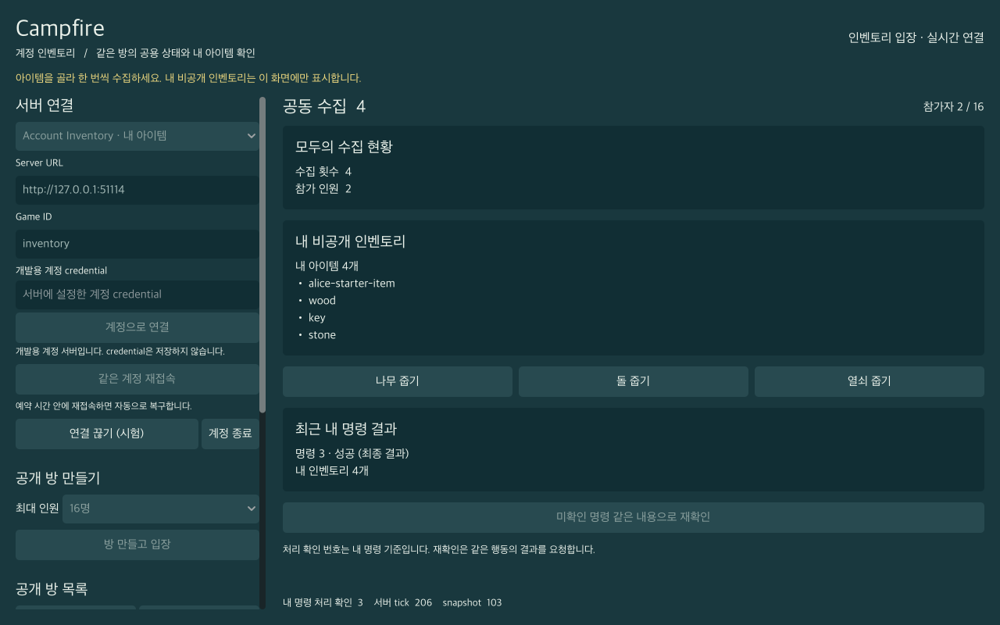
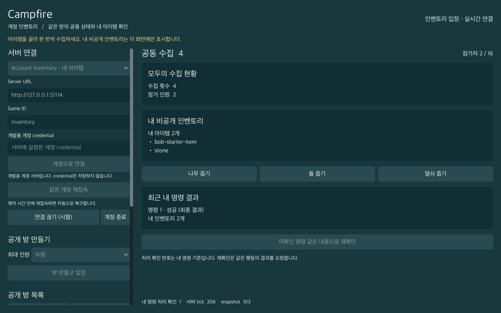

# Godot 계정·명령·개인 상태 검증

2026-10-18 22:09 KST에 production `main.tscn`을 서로 다른 두 native Godot 프로세스에서 실행했다. Alice/Bob이 같은 Inventory 방에서 공용 수집 4회를 확인하면서 각각 4개와 2개의 자신의 아이템·자신의 명령 결과만 표시했다. 실제 transport 회귀와 두 창의 총 86개 검사가 exit 0으로 통과했다. 외부 IdP와 영구 저장소는 연결하지 않았다.

원본 증거는 [`artifacts/godot-accounts-20261018-02/summary.json`](../artifacts/godot-accounts-20261018-02/summary.json), [Alice 결과](../artifacts/godot-accounts-20261018-02/alice.json), [Bob 결과](../artifacts/godot-accounts-20261018-02/bob.json)에 있다. source manifest, 정확한 실행 명령·PID·exit code와 서버/엔진 binary SHA가 summary에 함께 있다.

## 실제 두 native 창

| 항목 | Alice | Bob |
|---|---|---|
| 독립 Godot PID | 98618 | 98619 |
| DisplayServer / renderer | `macOS` / `gl_compatibility` | `macOS` / `gl_compatibility` |
| 화면 크기 | 1280 × 800 | 1280 × 800 |
| 자동 검사 / exit code | 45 / 0 | 41 / 0 |
| 동일 public 상태 | `total_collected=4`, `players=2` | `total_collected=4`, `players=2` |
| 자신의 private inventory | `alice-starter-item`, `wood`, `key`, `stone` | `bob-starter-item`, `stone` |
| 자신의 retained 결과 / 마지막 seq | 3개 / 3 | 1개 / 1 |





두 PNG는 각 프로세스가 `RenderingServer.frame_post_draw`를 기다린 뒤 실제 viewport에서 저장한 원본이다. headless dummy renderer가 아니다. QA 담당자와 coordinator가 원본을 각각 열어 공용 횟수·개인 목록·최근 결과·빈 credential란·한글·버튼 배치를 확인했다. 좌측 긴 방 목록은 scroll 영역이다. JSON의 최종 비교 시점은 양쪽 모두 같은 `snapshot_seq=102`이며 public dictionary가 일치했다.

## 검증한 흐름과 관측

- **계정·방 UI:** `Mode.select(1)`과 `item_selected.emit(1)`, credential `text_changed`, `AccountConnect.pressed`, `CreateRoom`, `RefreshRooms`, `RoomList.item_selected`, `JoinRoom`의 production handler를 사용했다. credential란은 `secret=true`이며 제출 직후 동기적으로 비었다. 두 다른 player ID가 정확히 같은 `room_id`와 `room_instance_id`에 입장했다.
- **공용·private 분리:** Alice wood, Bob stone, Alice key·stone을 수집했다. 최종 public dictionary가 양쪽에서 같았고, Alice snapshot·private·결과·화면 문자열에는 Bob starter가, Bob 쪽에는 Alice starter가 없었다. 공용 state에도 starter item이 없었다. Bob은 Alice의 추가 결과를 받지 않았다.
- **한 개 pending:** Alice의 seq 2가 미확인일 때 모든 새 수집 버튼이 disabled였고 adapter의 추가 명령 호출은 `COMMAND_PENDING`으로 거부됐다.
- **같은 명령 재확인:** 실제 WebSocket 응답을 버리는 동안 Bob이 public count 3을 먼저 관측해 서버의 key 수집 완료를 독립 확인했다. 이후 fixture가 transport의 해당 request lock만 제거하고 UI 재확인 버튼을 눌렀다. 보관된 membership·seq 2·payload `{"action":"collect","item":"key"}`는 그대로였으며 request ID만 `5-5`에서 `5-6`으로 바뀌었다. 서버의 retained 결과가 돌아왔고 총계는 3으로 유지됐다. 이 fixture는 자연 timeout 검증과 별개이며 OS 클릭 증거를 주장하지 않는다.
- **실제 timeout·resume:** 다음 seq 3 stone의 실제 terminal reply와 주기 snapshot을 버렸다. Bob이 public count 4를 먼저 관측한 뒤 실제 시계로 6.3초 기다렸고 production timeout이 `REQUEST_TIMEOUT`과 단절을 발생시켰다. private UI는 즉시 비워졌고 pending seq 3은 메모리에 남았다. production `Reconnect` 버튼으로 같은 player·room·instance를 resume하여 inventory 4개와 retained 결과 3개를 복구했다. 최근 결과 UI도 seq 3 성공으로 복원됐다. Alice는 두 단계에서 실제 terminal reply 2개와 snapshot 97개를 의도적으로 버렸다.
- **동일 계정 rotation:** 단절 뒤 Alice credential로 다시 로그인했다. runtime token의 실제 값이 메모리에서 바뀌었고 기존 player·room·instance·inventory·결과는 유지됐다. token 값은 증거에 기록하지 않았다.
- **identity·context 수명:** logout 후 개인 상태·결과·pending·자격을 비웠다. Bob 창에서 Alice로 바꿨을 때 새 identity가 이전 Bob membership·inventory·결과를 상속하지 않았고 새 방에는 Alice starter만 있었다. 단절 중 game ID 편집은 기존 자격·방을 폐기하고 Reconnect를 비활성화했다. profile 변경도 개인 정보와 계정 자격을 비웠다.
- **서버 오류:** 잘못된 credential의 실제 오류 `UNAUTHENTICATED`, verifier 없는 기본 서버의 `ACCOUNT_AUTH_DISABLED`를 production UI가 표시했다. 실패 뒤 과거 개인 상태는 복원되지 않았다.

UI 조작은 production Control signal 경로이며 OS의 물리 마우스·키보드 입력으로 보고하지 않는다. 응답 유실 fixture는 adapter polling을 잠시 멈추고 실제 `WebSocketPeer.poll/get_packet`으로 수신한 메시지를 버린다. 같은 명령 retry fixture는 transport request tracker를 명시적으로 해제한다. 자연 timeout→단절→UI Reconnect→full sync 복원은 tracker를 수정하지 않고 별도로 통과했다. 실제 transport suite도 lost reply·같은 seq 재전송·rotation·logout을 검증했다.

## 실행과 출처

서버와 Godot은 모두 macOS arm64의 TCP loopback에서 실행했다. 엔진은 `4.7.2.stable.official.ed1daf0bf`, OpenGL 4.1 Metal / Apple M2, 최대 30fps, Dummy audio다. 개발용 account 서버의 기본 bind는 `127.0.0.1:3001`로 유지하고 QA에만 `CAMPFIRE_DEMO_BIND`로 임의의 빈 포트를 주입했다. guest-only 기본 서버도 별도 빈 포트를 사용했다. 계정 transport와 native 검사는 순차 실행했고 그 사이 account runtime을 재시작하여 앞 검사의 token rotation과 방 상태가 뒤 검사에 영향을 주지 않게 했다.

```sh
cargo build -p campfire-server --no-default-features --example account_server --locked --offline
cargo build -p campfire-server --locked --offline
python3 -u tools/validate_godot_accounts.py --godot /opt/homebrew/bin/godot \
  --skip-build --output artifacts/godot-accounts-20261018-02
```

다시 실행할 때는 존재하지 않는 새 output 디렉터리를 지정한다. runner는 stdlib만 사용하며 기본 실행은 두 서버를 순차 빌드한다. `--skip-build`는 이미 빌드한 binary를 그대로 검증할 때 쓴다.

검증한 worktree의 기준 commit은 `a5396690da80db4fbfc129e36d70c25d17b79a0c`이며 미커밋 구현을 source manifest로 고정했다. 실행 전후 SHA가 모두 같았다. 최종 Git 전달은 coordinator의 commit·remote SHA 확인으로 별도 증명한다.

| 대상 | SHA-256 |
|---|---|
| source manifest digest, 실행 전 = 후 | `3ccd870ec5ead722af60c47d2f2b15725ba002ff8babe46e4f46e32ece78bf6d` |
| Godot binary, 실행 전 = 후 | `c7cccbf8fb143e34e02fd6521e09be2c2b974f0d5db080b19071c9c570718ccf` |
| account_server binary, 실행 전 = 후 | `a9dbe4391f343fede18cac8266f9a5c2bf190d1ff9bf9062be2bb259edec6b28` |
| arena server binary, 실행 전 = 후 | `9a3655a2d1efe66921284abbdb61eefe2b95fbc844ee077df122aadbe2eeb7b3` |

랜덤 credential 3개는 환경 변수로만 전달했다. runner는 실제 credential 값과 token 형태를 13개 원본 artifact에서 검색해 누출이 없음을 확인했고, native harness는 로그인·rotation에서 관측한 실제 token 값도 메모리에서만 모아 자신의 report와 당시 JSON/log에 검색한 뒤 폐기했다. PNG의 credential란도 비어 있다. 서버·GUI 등 runner가 `Popen`으로 만든 프로세스 6개는 모두 exit 0으로 종료됐고 cleanup 후 생존 프로세스가 없었다. 기존 사용자 서버 PID 63797·Godot PID 65028에는 signal을 보내지 않았다.

첫 실행 [`godot-accounts-20261018-01`](../artifacts/godot-accounts-20261018-01/summary.json)은 핵심·timeout·rotation 이후 잘못된 credential의 `UNAUTHENTICATED` code가 UI의 게스트 설명에 가려져 실패했다. 오류 code를 보존하는 고정 계정 안내로 수정하고 UI smoke RED→GREEN 후 새 디렉터리 02에서 전체를 다시 실행했다. 실패 증거는 덮어쓰지 않았다.

## 단위·UI 및 기존 Arena 회귀

Coordinator가 최종 production source에서 독립 실행한 [client 단위 로그](../artifacts/godot-accounts-20261018-02/unit.log)는 `PASS: CampfireClient unit invariants`, [UI smoke 로그](../artifacts/godot-accounts-20261018-02/ui-smoke.log)는 `UI_SMOKE_PASS`로 각각 exit 0이었다. 이 두 sandbox 실행 로그에는 기존 macOS engine의 `get_system_ca_certificates` / `Condition "ret != noErr"` 진단이 있다. 이는 Godot의 시스템 CA 탐색에서 출력된 환경 진단이며 GDScript parse/runtime 실패와 구분한다. 별도 실제 transport·native 실행 로그에는 해당 진단과 script 오류가 없고 모든 서버 접속이 성공했다.

같은 source 동결 뒤 coordinator가 기존 runner를 실행했다. [Arena 회귀 summary](../artifacts/godot-accounts-20261018-02/legacy/summary.json)는 `success:true`, runner exit 0이며 8명·16명 모두 동일 snapshot sequence의 public 상태·원격 이동·기본 adapter의 동일 identity/room/instance resume을 확인했다.

```sh
python3 -u tools/validate_godot.py --godot /opt/homebrew/bin/godot \
  --counts 8 16 --duration 20 --skip-build \
  --output artifacts/godot-accounts-20261018-02/legacy
```

| 실제 Godot 프로세스 | 측정 시간 | 전원 동일 public snapshot | client snapshot 간격 p95 최대 | 처리 input ack 범위 |
|---|---|---|---|---|
| 8개 | 20.640초 | 19개 sequence | 69ms | 388–419 |
| 16개 | 20.652초 | 19개 sequence | 70ms | 382–431 |

기존 [native Arena UI 검사](../artifacts/godot-accounts-20261018-02/legacy/integration.json)는 28개 검사를 4.943초에 통과했고 예상하지 않은 오류는 없었다. 다른 game의 방 입장 오류 `GAME_MISMATCH`는 의도한 거부 검사다. legacy runner의 별도 source digest는 `91e623c7af3d2761a312124098dc8a5565d607bb4c3ada5f18dabbbcc591087e`이며 두 runner가 사용하는 manifest 범위·digest 방식은 다르다. 사용한 arena binary는 위 표와 같은 SHA였다. `cargo fmt --all --check`와 `cargo clippy -p campfire-server --example account_server --no-default-features --locked --offline -- -D warnings`도 exit 0이었다.

이 실행은 개발용 verifier, 두 native 계정, loopback UI/transport의 근거다. 외부 IdP 연동, WAN·TLS·서버 재시작 후 영속 복구, 명령 이력 퇴출 이후의 durable exactly-once를 증명하는 실행은 아니다.
