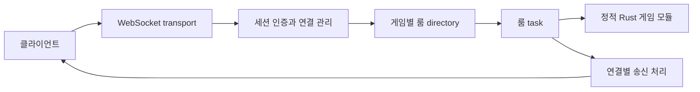

# Campfire 공통 게임 서버 프레임워크 사양서

상태: 사양서 작성 단계 · 설계 검토 완료

프로젝트명은 **Campfire(캠프파이어)**이며, 기본 영문 식별자는 `campfire`다. 게임 속 파티원들이 모여 정비하고 다음 모험을 준비하는 모닥불에서 가져온 이름으로, 여러 플레이어가 모이는 협동·파티 멀티플레이 기반을 뜻한다.

여러 게임이 연결과 룸 운영을 공유하고, 게임별 Rust 모듈을 연결해 전용 서버도 구성할 수 있는 구조를 정의한다.
현재 산출물은 이 사양서이며, 아래 개발 범위와 검증 기준은 별도의 구현 요청이 있을 때 적용한다. 첫 검증 대상은 8인 이상 협동 및 파티 게임이다.
GameAnvil과 사용자가 언급한 ‘콜로서스’는 방향을 설명하는 참고 대상이다. ‘콜로서스’가 Colyseus를 뜻하는지는 확정되지 않았다.

## 확정 요구와 제안 기본값

| 구분 | 항목 | 내용 |
| --- | --- | --- |
| 확정 요구 | 구현 언어 | Rust |
| 확정 요구 | 재사용 | 여러 게임용 공통 서버 프레임워크와 게임별 모듈 |
| 확정 요구 | 배포 구성 | 선택한 게임 모듈만 포함하는 전용 서버 구성 가능 |
| 확정 요구 | 플레이 | 룸당 최소 8인 이상, 게스트 접속, 실시간 처리 |
| 확정 요구 | 첫 검증 장르 | 8인 이상 협동 및 파티 게임 |
| 제안 기본값 | 초기 실행 단위 | 단일 프로세스, 단일 노드 |
| 제안 기본값 | 기술 조합 | Tokio, Axum, WebSocket, Serde JSON |
| 제안 기본값 | 기본 룸 정원 | 16명, 게임별 설정으로 변경 가능 |
| 제안 기본값 | 시간 처리 | 30Hz tick, 15Hz full snapshot |
| 제안 기본값 | 세션 수명 | 게스트 토큰 TTL 24시간, 재접속 유예 30초 |

16명 정원과 처리 주기는 첫 실험의 출발점이다. 목표 부하에서 측정한 결과에 따라 조정하며 대규모 수용량을 의미하지 않는다.
프레임워크가 자동 생성하는 delta synchronization은 1차 범위에 포함하지 않는다.

## 게임 모듈 연결 방식

| 접근 | 구성 | 장점 | 비용과 판단 |
| --- | --- | --- | --- |
| 정적 Rust 게임 모듈 | 서버 바이너리에 선택한 모듈을 함께 컴파일 | 타입 검사, 호출 경로 단순화, 단일 실행 파일 | 배포 때 재빌드 필요. 1차 권고안 |
| 별도 게임 서비스 | 공통 서버와 게임 실행 서비스를 RPC로 연결 | 게임별 독립 배포와 프로세스 격리 | 네트워크 실패, 상태 전달, 운영 복잡도 증가. 후속 선택지 |
| WASM 또는 동적 플러그인 | 실행 중 모듈을 적재하거나 sandbox에서 실행 | 확장과 교체의 유연성 | ABI, 자원 제한, 호출 비용 검증 필요. 1차 보류 |

1차 게임 모듈은 운영자가 신뢰하는 Rust 코드다. 룸을 별도 task로 실행해도 OOM이나 process abort를 다른 룸으로부터 격리하지 못한다.
게임별 강한 장애 격리가 필요해지면 서버 바이너리를 게임별 프로세스로 분리하고, 별도 게임 서비스 접근을 다시 평가한다.

## 구성 요소와 상태 소유권



| 구성 요소 | 소유 책임 | 다른 계층에 넘기는 책임 |
| --- | --- | --- |
| Framework | 게임 등록, 룸 directory, 생성 및 종료, 공통 제한, 오류 규약 | 게임 규칙과 물리 판정 |
| Session | 게스트 식별, TTL, 연결 generation, 재접속 권한 | 룸의 자리 예약과 게임 상태 |
| Room | 멤버십과 자리 예약, tick, 입력 순서, snapshot 발행, 생명주기 | 소켓 읽기와 쓰기 |
| Transport | 메시지 인코딩, 프레임 제한, 인증 기한, 연결별 송수신 | 게임 입력의 의미와 유효성 |
| Game module | 입력 검증, 게임 상태 변경, 승패와 점수, 공개 상태 구성 | 토큰 발급과 네트워크 연결 |

각 룸 task만 자신의 멤버십과 게임 상태를 변경한다. 외부 task는 명령을 queue에 넣고 응답을 받으며 상태를 직접 공유해 수정하지 않는다.
게임 모듈은 룸 task 안에서 동기적인 상태 전이를 수행한다. 외부 I/O를 기다리며 tick을 막는 작업은 허용하지 않는다.
Framework는 tick과 입력 처리 시간을 측정한다. 처리 예산 초과를 관측하되, 실행 중인 신뢰 코드의 강제 중단이나 자원 격리를 보장하지 않는다.
Transport 교체는 룸 명령과 출력 계약을 유지한다. 게임 모듈은 Axum 타입이나 WebSocket 객체를 받지 않는다.
세션 관리자는 게스트별 `create`, `join`, `leave`, `resume`, 인증 연결 교체를 직렬화한다. 두 연결이 같은 게스트를 동시에 다른 룸에 넣을 수 없다.
세션이 보관하는 룸 참조는 교차 룸 명령 조정을 위한 기록이다. 실제 자리 확정과 변경은 해당 룸 task의 확인을 받아 반영한다.
Framework는 룸 task의 정상 종료와 unwind panic 종료를 감지해 directory와 세션의 룸 참조를 정리하고 참가자에게 `room.closed`를 알린다.
마지막 멤버와 예약 자리가 모두 사라지면 룸을 종료한다. 이 task 감독은 process abort나 OOM의 격리를 보장하지 않는다.

## 게임 경계와 룸 식별

`game_id`는 서버에 등록된 게임 식별자이며 게스트 발급, 연결, 룸 생성, 목록, 입장, 재접속 전 구간에 적용한다.
게스트 토큰도 한 `game_id`에 속한다. 게임 A 토큰으로 게임 B 연결을 인증하거나 게임 B 룸에 입장할 수 없다.
룸 directory는 `(game_id, room_id)`로 조회한다. 목록에는 인증한 게임의 공개 룸만 반환한다.
입장과 재접속은 조회 결과뿐 아니라 토큰의 게임, 연결의 게임, 룸의 게임이 모두 같은지 다시 검사한다.

`room_id`는 외부에서 사용하는 룸 식별자다. `room_instance_id`는 생성될 때마다 새로 발급하는 값으로 룸 epoch 역할을 한다.
룸 ID가 재사용되더라도 과거 instance의 입력과 재접속 요청은 거부한다. 프로세스 재시작 뒤에는 이전 룸과 세션을 복원하지 않는다.
정원에는 연결된 플레이어와 재접속 유예 중인 예약 자리가 모두 포함된다. 관전자 기능은 1차 범위에서 제공하지 않는다.
입장 정원 판정과 자리 할당은 룸 task에서 하나의 명령 처리로 수행해 동시 입장 경합을 막는다.
생성 중인 임시 룸은 자동 입장이 commit될 때까지 목록에 노출하지 않는다. commit 전 실패나 취소는 자리와 임시 룸을 rollback한다.
기존 룸 입장도 확정 전 실패나 취소라면 임시 자리를 해제한다. 세션의 직렬화는 룸의 commit 또는 rollback 확인까지 유지한다.
입장 확정 뒤 응답 전송이 실패하면 이미 확정한 입장을 취소하지 않고 단절 및 30초 자리 예약으로 전환해 `resume`으로 복구한다.

## 게스트 인증과 연결 생명주기

`POST /v1/games/{game_id}/guests`는 서버가 생성한 게스트 ID, 추측 불가능한 bearer token, 만료 시각을 반환한다.
토큰은 OS의 암호학적 난수로 발급하고 서버에는 검증용 해시를 보관한다. TTL 24시간은 발급 시점부터 계산하는 제안값이다.
세션 저장소는 인메모리다. 로그아웃은 현재 프로세스의 토큰을 폐기하고 연결 및 예약 자리를 해제한다. 재시작 뒤에는 토큰이 유효하지 않다.
HTTP 로그아웃 API는 추가하지 않고 인증된 WebSocket의 `session.logout` 명령을 사용한다.

클라이언트는 토큰 없이 `/v1/games/{game_id}/ws`에 연결하고 5초 안에 첫 메시지 `session.authenticate`로 토큰을 보낸다.
첫 메시지가 인증이 아니거나 기한이 지나면 연결을 닫는다. 인증 전에는 룸 및 게임 명령을 처리하지 않는다.
토큰을 URL, access log, 메시지 원문 로그에 기록하지 않는다. 외부 노출 환경에서는 HTTPS와 WSS로 전달한다.
새 인증은 게스트별 직렬화 안에서 새 `connection_generation`을 할당하고 구 연결을 무효화한다.
기존 룸이 있으면 세션 관리자가 룸에 명시적 연결 교체 명령을 보내 generation 갱신과 단절 예약 전환을 확인한 뒤 인증 성공을 반환한다.
활성 자리는 이때 30초 예약으로 바뀌며 이미 예약 중이면 기존 만료 시각을 유지한다. 반복 인증으로 유예를 연장하지 않는다.
기존 룸이 종료되어 확인할 수 없으면 감독 절차로 룸 참조를 정리한 뒤 멤버십 없는 인증 결과를 반환한다.
`session.authenticated`는 현재 `room_id`, `room_instance_id`, `can_resume`, 예약 만료 시각을 반환하며 룸이 없으면 식별자는 null이다.
새 연결은 인증만으로 게임 조작을 재개하지 않고 `resume`을 완료해야 한다. 이후 모든 명령에는 서버가 generation을 붙여 검증한다.
클라이언트가 보낸 generation 값을 권한 근거로 사용하지 않는다. 구 연결의 지연 입력과 종료 알림은 새 연결의 상태를 변경하지 못한다.

연결 단절 시 룸은 자리를 30초 예약한다. 게임 모듈은 단절 플레이어의 조작을 중지하고 게임별 대기 동작을 적용한다.
예약 만료, 토큰 만료, 로그아웃 중 먼저 발생한 조건이 자리를 해제한다. 토큰 만료는 활성 연결도 종료하며, 룸이 먼저 종료되면 재접속할 수 없다.
`room.leave`는 명시적 퇴장이므로 즉시 자리를 해제한다. 같은 요청의 재전송은 성공으로 응답하되 자리를 다시 만들지 않는다.
유예 안의 `resume`은 토큰, 게임, 룸 instance, 예약된 플레이어를 확인한 뒤 현재 인증 generation으로 조작을 재개한다.
유효 토큰이 있는 사용자는 명시적 퇴장 뒤 일반 입장으로 돌아올 수 있지만, 이전 예약에 대한 `resume`은 거부한다.

게스트 발급 빈도, 전체 세션 수, 미인증 연결 수, 전체 연결 수, 전체 룸 수에는 각각 유한한 설정 상한을 둔다.
발급 제한은 발급 주체별 및 서버 전체 한도를 함께 적용하며, 최근 발급 rate key에도 만료를 적용하고 key 수를 제한한다.
상한에 도달하면 신규 발급이나 연결 및 생성을 거부한다. 만료 세션은 주기적으로 정리하고 연결과 룸 예약도 해제한다.
연결, 룸, 임시 생성 예약의 카운터는 실패와 취소 및 종료 경로에서도 반환하며 상한에 숨은 영구 예약을 남기지 않는다.

## 제안 프로토콜과 전송 순서

아래 계약은 이 프레임워크를 위한 제안이며 외부 Rust 라이브러리의 기존 API나 스키마를 뜻하지 않는다.
모든 메시지는 `v: 1`과 `type`을 가진 JSON envelope를 사용한다. 클라이언트 명령에는 연결 안에서 고유한 `request_id`를 넣는다.
서버는 직접 응답과 오류에 같은 `request_id`를 돌려준다. 정기 snapshot에는 `request_id`가 없다.
알 수 없는 버전과 메시지 타입, 누락 필드, 잘못된 타입은 명시적 오류로 처리하며 임의로 보정하지 않는다.

| 메시지 | 방향 | 주요 필드와 처리 결과 |
| --- | --- | --- |
| `session.authenticate` | Client → Server | `token`; 연결 교체 확인 후 게스트, 만료, 현재 룸과 `can_resume`을 `session.authenticated`로 반환 |
| `session.logout` | Client → Server | 토큰 폐기와 자리 해제 후 `session.logged_out`, 연결 종료 |
| `room.create` | Client → Server | `settings`; 허용 설정 검증 후 생성자 자동 입장, `room.entered` 반환 |
| `room.list` | Client → Server | `cursor`, `limit`; 같은 게임의 룸과 다음 cursor를 `room.listed`로 반환 |
| `room.join` | Client → Server | `room_id`, `room_instance_id`; 정원과 권한 검사 후 `room.entered` 반환 |
| `room.leave` | Client → Server | 현재 룸 식별자; 즉시 해제 후 `room.left` 반환 |
| `resume` | Client → Server | `room_id`, `room_instance_id`; 인증 후 예약 복구, `room.resumed` 반환 |
| `game.input` | Client → Server | 룸 식별자, `input_seq`, `payload`; 게임별 검증 후 tick에서 처리 |
| `snapshot` | Server → Client | 룸 식별자, `server_tick`, `snapshot_seq`, `last_processed_input_seq`, `state` |
| `room.closed` | Server → Client | 룸 식별자, `reason`; 종료된 룸 참조 제거, 해당 룸 resume 불가 |
| `error` | Server → Client | `request_id`, `code`, `message`, `retryable`; 확정 전 명령 거부와 서버 과부하를 구분 |

한 게스트는 예약 자리를 포함해 동시에 한 룸에만 속한다. 다른 룸에 입장하려면 먼저 퇴장한다.
명령 검증 거부는 게임 상태를 변경하지 않는다. 입장 확정 후 송신 실패와 연결 교체에 따른 예약 전환은 위 생명주기 규칙을 따른다.
`request_id`는 상관관계 식별자다. 연결별 제한된 응답 캐시로 동일 요청의 재전송을 처리하고, 같은 ID에 다른 본문을 보내면 거부한다.
캐시가 사라진 새 연결에서 생성 요청을 재전송하면 서버가 현재 멤버십을 확인하며, 이미 속한 룸이 있으면 중복 생성하지 않는다.

```json
{"v":1,"type":"room.join","request_id":"join-1","room_id":"r42","room_instance_id":"inst-7"}
```

```json
{"v":1,"type":"game.input","request_id":"input-19","room_id":"r42","room_instance_id":"inst-7","input_seq":19,"payload":{"move_x":1,"move_y":0}}
```

```json
{"v":1,"type":"snapshot","room_id":"r42","room_instance_id":"inst-7","server_tick":120,"snapshot_seq":60,"last_processed_input_seq":19,"state":{"players":[{"id":"g8","x":2.5,"y":1.0}],"shared_score":3}}
```

`input_seq`는 플레이어와 룸 instance별 증가 정수다. 같은 generation에서 이미 수신한 번호 이하는 `STALE_INPUT`으로 거부하며 과도한 번호 도약도 거부한다.
룸은 `game.input`을 상태에 적용하기 직전에 generation을 다시 확인한다. 연결 교체 시 구 generation의 미처리 입력은 모두 폐기한다.
`last_processed_input_seq`는 실제 게임 처리에 반영한 마지막 번호다. queue에 수신했거나 폐기한 번호를 처리 완료로 확인하지 않는다.
재접속 full sync는 이 번호를 유지한다. 서버의 수신 순서 기준과 새 연결의 전송 sequencer를 이 번호로 재설정하고 다음 번호부터 시작한다.
폐기된 구 연결 번호를 새 generation이 다시 사용해도 구 입력은 generation 검사로 차단한다. 클라이언트는 이전 미처리 입력을 자동 재생하지 않는다.
`server_tick`은 룸의 tick 번호, `snapshot_seq`는 룸이 발행한 snapshot 번호다. 재접속으로 두 번호를 초기화하지 않는다.
`last_processed_input_seq`는 수신자 자신의 확인값이며, 다른 플레이어의 확인값을 대신 보내지 않는다.

입장 처리는 룸 task에서 멤버십 확정, full state 캡처, `room.entered` enqueue, 후속 snapshot 구독 순서로 진행한다.
`room.entered`와 `room.resumed`는 같은 snapshot 필드를 포함한 full sync를 담는다. 송신 task는 이를 보낸 뒤 최신 snapshot 슬롯을 읽는다.
연결별 단일 송신 task가 순서를 보장한다. 초기 state보다 후속 snapshot이 먼저 도착하는 경로를 만들지 않는다.
클라이언트는 다른 instance의 상태와 이미 적용한 번호 이하의 snapshot을 버린다. 재접속은 항상 새 full sync로 시작한다.
주요 오류 코드는 `UNAUTHENTICATED`, `GAME_MISMATCH`, `ROOM_NOT_FOUND`, `ROOM_FULL`, `RESUME_EXPIRED`, `STALE_INSTANCE`, `STALE_INPUT`, `RATE_LIMITED`, `SERVER_BUSY`다.
외부 HTTP 경로는 게스트 발급과 WebSocket, 상태 확인용 `GET /health`만 제공한다. `/health`는 게임 상태나 토큰 정보를 반환하지 않는다.

## 입력 제한과 느린 연결 처리

입력 queue와 reliable event queue는 모두 bounded queue다. 용량을 초과할 때 무한 대기하거나 메모리를 계속 늘리지 않는다.
초기 제안은 연결별 최대 JSON 프레임 16KiB, 게임 입력 초당 60개와 순간 burst 30개, 룸 입력 queue 1,024개다.
연결별 reliable event queue는 64개, 최신 snapshot은 1개 슬롯으로 시작한다. 모든 값은 서버 설정으로 조정한다.
스키마 검사와 연결별 빈도 제한은 룸 queue 앞에서 수행한다. 룸은 플레이어별 tick당 처리량도 제한해 한 사용자의 입력 독점을 막는다.
공유 룸 입력 queue가 가득 차면 `SERVER_BUSY`와 `retryable: true`로 거부하고 서버 과부하 지표를 기록한다. 사용자 위반 횟수에는 포함하지 않는다.
연결 제재는 개인별 프레임 크기 및 빈도 제한 위반으로만 판단한다. 처리하지 않은 입력을 처리 완료로 확인하지 않는다.

최신 snapshot 슬롯은 이전 snapshot을 대체할 수 있다. 신뢰성 이벤트와 입장 full sync는 이 슬롯에 넣지 않는다.
룸 task는 각 연결의 bounded queue에 비차단으로 출력한다. 하나의 소켓 쓰기 완료를 기다리며 전체 룸 tick을 멈추지 않는다.
reliable event queue가 가득 차거나 소켓 쓰기 기한을 반복해서 넘으면 해당 연결만 종료하고 재접속 절차를 적용한다.
이때 마지막 snapshot 이후의 상태는 재접속 full sync로 회복한다. 1차 샘플에는 반드시 개별 전달되어야 하는 게임 이벤트를 두지 않는다.
연결별 과도한 입력과 룸 전체 과부하를 별도 지표로 기록한다. 특정 abuser의 위반을 정상 플레이어의 위반으로 집계하지 않는다.
프레임 크기 반복 초과와 지속적인 빈도 위반은 해당 연결을 종료한다. 정상 연결의 일시적인 queue 포화는 재시도 가능한 오류로 알린다.

## 첫 게임 모듈과 클라이언트

첫 모듈은 2D 파티 arena로 구성한다. 플레이어는 평면 안에서 이동하며 공동 목표 지점에 도달하면 공유 점수를 얻는다.
서버는 방향 입력의 범위, 이동 속도, 경계, 목표 획득 조건을 검증하고 위치와 점수를 계산한다.
샘플은 플레이어별 tick 안의 최신 유효 방향 하나만 선택한다. 길이가 1을 넘으면 정규화해 대각선 이동 속도를 제한한다.
이동량은 tick마다 `direction * speed * fixed_dt`로 한 번 계산한다. 메시지 수신 자체로 이동하지 않아 전송 빈도가 속도를 바꾸지 않는다.
그 tick에 선택한 입력 번호를 처리 완료로 기록하고 더 오래된 입력은 폐기한다. 연결 단절과 교체 시 보관 방향을 0으로 만든다.
클라이언트가 보내는 위치나 점수는 채택하지 않는다. 같은 tick에 목표를 획득한 경우에도 룸의 처리 순서에 따라 한 번만 점수를 올린다.
충돌, 물리, 플레이어별 행동, 승패는 게임 모듈의 책임이다. Framework는 범용 물리 엔진이나 FPS 판정을 제공하지 않는다.
기본 snapshot은 플레이어 ID와 위치, 연결 상태, 공유 점수, 목표 상태를 포함한다. 단절 플레이어는 예약 만료 전까지 정지한다.
전용 SDK는 의무가 아니다. 첫 검증은 protocol을 직접 사용하는 CLI 또는 headless WebSocket client로 수행한다.

## 구현 승인 후 검증 기준

| 검증 | 실행 조건 | 합격 기준 |
| --- | --- | --- |
| 기본 흐름 | 실제 WebSocket client 8명과 16명으로 각각 실행 | 생성, 입장, 입력, snapshot 수신, 퇴장, 종료가 계약대로 동작 |
| 정원 경합 | 15명 입장 후 2명이 동시에 마지막 자리 요청 | 한 명만 성공하고 나머지는 `ROOM_FULL`, 멤버는 16명 |
| 재접속 | 강제 단절 후 30초 전후에 각각 복구 | 유예 안에서는 같은 플레이어 full sync, 만료 뒤에는 거부와 자리 해제 |
| 게임 경계 | A 토큰과 연결로 B의 생성, 목록, 입장, resume 시도 | 경로 및 대상 검증에서 거부하고 B 상태 변화 없음 |
| 오래된 연결 | 새 인증과 resume 뒤 구 연결의 입력과 종료 전달 | 새 연결과 멤버십이 유지되고 구 generation의 명령은 무효 |
| 중복 인증과 입장 | 같은 게스트의 두 연결이 동시 인증과 서로 다른 룸 입장 시도 | 직렬화로 한 멤버십만 확정, 구 연결 종료가 새 예약을 해제하지 않음 |
| 입장 중 단절 | commit 전과 commit 후 응답 전송 전에 각각 단절 | 전자는 자리 및 임시 룸 rollback, 후자는 예약과 full sync 복구 |
| 입력 순서 | 중복, 역순, 과도한 도약, 과거 instance 입력 전송 | 중복 상태 변경 없이 정해진 오류로 거부 |
| 미처리 입력 교체 | 구 generation 입력을 queue에 둔 채 새 인증과 resume | 구 입력 미적용, full sync 확인값 다음 번호부터 새 입력 적용 |
| 이동 속도 | 같은 시간과 방향을 서로 다른 허용 전송 빈도로 입력 | 고정 tick 기준 이동 거리와 대각선 최대 속도가 동일 |
| 초기 순서 | 입장과 snapshot 발행을 같은 시점에 경합 | full sync가 먼저 도착하고 이후 번호가 증가 |
| 느린 수신자 | 한 client의 읽기를 정지하고 다른 15명은 정상 유지 | queue 상한 유지, 해당 연결만 종료, 다른 client의 진행 유지 |
| 입력 폭주 | 한 연결이 크기와 빈도 제한을 지속 초과 | 해당 연결 제재, 정상 연결은 입력과 snapshot 처리 지속 |
| 공유 queue 포화 | 개인 제한 이내의 정상 연결들로 공유 queue 포화 | `SERVER_BUSY` 반환과 과부하 기록, 개인 위반 및 제재 증가 없음 |
| 상한과 만료 | 발급, 세션, 연결, 룸 상한 도달 후 manual clock 진행 | 추가 수용 거부, 만료 세션 및 rate key 정리, 자리와 카운터 회수 |
| 룸 종료와 panic | 마지막 예약 만료 및 룸 task의 unwind panic 유도 | directory와 세션 참조 정리, 가능한 연결에 종료 알림, resume 거부 |
| 결정성 | manual clock으로 같은 초기 상태와 입력 순서 재생 | tick, 만료, 자리 해제, 최종 공개 상태가 동일 |

통합 검증은 최소 60초 동안 8명 및 16명 시나리오를 각각 실행하고 입력 처리와 snapshot 간격, tick 지연, queue 깊이를 기록한다.
느린 수신자 테스트에서는 정상 client의 snapshot 간격 p95가 동일 환경의 기본 실행 대비 2배 이내인지 함께 확인한다.
이 기준을 넘으면 원인을 수정하고 다시 검증한다. 이는 해당 실행 환경의 회귀 기준이며 다른 하드웨어의 성능 보장이 아니다.
자동 검증 결과에는 실행 명령, 빌드 식별자, 설정, 테스트 환경과 측정값을 남긴다.
대규모 CCU, 장시간 운영, public deployment, 실제 인터넷 지연에서의 품질은 별도 검증으로 다룬다.

## 향후 개발 범위

향후 구현 요청 시 1차 개발 범위는 공통 runtime, 게임 모듈 예제, 실행 가능한 서버 바이너리, protocol README, headless client 통합 테스트다.
해당 README는 게임 등록과 실행, 게스트 발급, 접속 인증, 룸 입장, 입력 전송, 재접속을 같은 예제로 연결해야 한다.
해당 바이너리는 게임 모듈 선택과 정원 및 queue 설정을 제공하고, 로그에 게임과 룸 식별자 및 지연 지표를 남겨야 한다.
분산 room directory, Redis와 DB 영속화, MMO, FPS 전용 transport, production dashboard는 후속 범위다.
후속 범위를 추가할 때도 `game_id` 경계와 룸 상태의 단일 소유권을 유지하고 장애 및 복구 계약을 별도로 정한다.

## 공식 참고와 설계 선택

[Colyseus Room 문서](https://docs.colyseus.io/room)와 [룸 인증 문서](https://docs.colyseus.io/auth/room)는 룸과 인증 책임을 비교하는 참고 자료다.
[Tokio bounded mpsc channel](https://docs.rs/tokio/latest/tokio/sync/mpsc/fn.channel.html)은 제한된 channel, [Axum WebSocket 문서](https://docs.rs/axum/latest/axum/extract/ws/index.html)는 WebSocket 연결 처리의 공식 참고다.
이 자료들이 위 수치나 메시지 계약을 정해 주지는 않는다. 정원, 주기, 세션 정책과 API 계약은 이 설계의 제안값이다.
GameAnvil과의 API 호환이나 동작 일치는 검증 기준으로 삼지 않는다.
